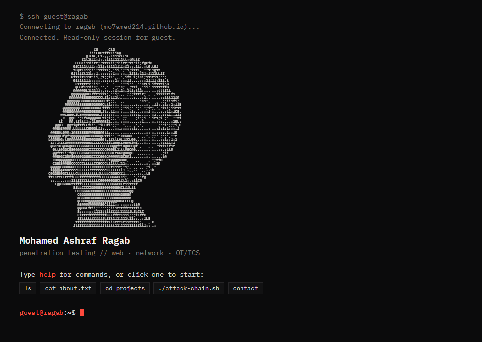

# ssh guest@ragab

My profile as a read-only terminal session. You connect, get an ASCII portrait, and then `ls`, `cd` and `cat` your way through my experience, thesis, projects and skills.



## Connect

**In a browser** (folders and files are clickable if you'd rather not type):

https://mo7amed214.github.io/terminal

**From your own terminal** (Python 3.8+, no dependencies):

```sh
pipx run --spec git+https://github.com/mo7amed214/terminal ragab
```

or install it:

```sh
pip install git+https://github.com/mo7amed214/terminal
ragab
```

If `ragab` isn't found (common on Windows, where Python's Scripts folder often isn't on PATH), run `python -m ragab` instead.

**Just the card:**

```sh
curl -s https://mo7amed214.github.io/terminal/card.txt
```

(In Windows PowerShell, use `curl.exe`.)

## Commands

| command | what it does |
| --- | --- |
| `ls [-a] [-l] [dir]` | list a directory |
| `cd <dir>` | change directory, `cd ..` to go up |
| `cat <file>` | print a file |
| `tree` | everything below the current directory |
| `./attack-chain.sh` | replay the attack chain from my thesis (in `~/thesis`) |
| `open linkedin` | open a link (`linkedin`, `github`, `site`) |
| `help`, `whoami`, `pwd`, `banner`, `history`, `clear`, `exit` | the usual |

Tab completion and the up and down arrows work. People who check hidden files will find something.

## How it works

- [`home/`](home) holds the content as plain text files. That folder is the filesystem you browse.
- [`tools/build.py`](tools/build.py) packs `home/` and the ASCII portraits in [`art/`](art) into `ragab/data.json`, and renders `card.txt`.
- The browser version ([`index.html`](index.html), [`terminal.js`](terminal.js)) and the Python version ([`ragab/shell.py`](ragab/shell.py)) both read that one file.

To change something, edit a file in `home/`, run `python tools/build.py`, and commit.

---

[mo7amed214.github.io](https://mo7amed214.github.io) · [LinkedIn](https://www.linkedin.com/in/mohamed-ashraf-ragab/)
